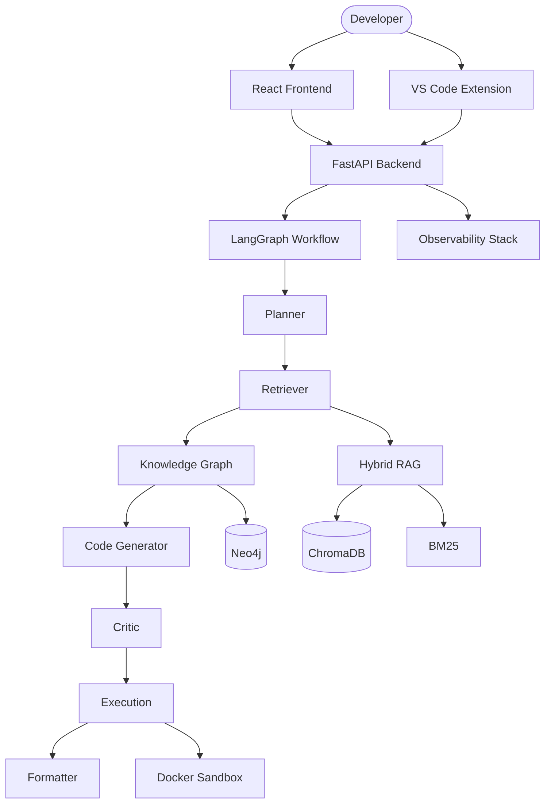

# ArchonAI — Agentic Code Intelligence Platform

<p align="center">
  
  
  
  
</p>

**ArchonAI** is a production-grade agentic code intelligence platform that combines multi-agent orchestration, hybrid retrieval-augmented generation, repository knowledge graphs, QLoRA fine-tuning, and enterprise observability — purpose-built for understanding and generating accurate, cited, verifiable code solutions across major AI framework codebases.

---

## Why ArchonAI?

| Capability | ArchonAI | Basic RAG Chatbot |
|-----------|----------|-------------------|
| Multi-agent pipeline | 7 specialized agents | Single LLM call |
| Hybrid retrieval | ChromaDB + BM25 + RRF | Vector only |
| Knowledge graph | Neo4j + NetworkX | None |
| Code execution | Docker sandbox + self-correction | None |
| Fine-tuning | QLoRA 4-bit pipeline | None |
| Evaluation | 10+ metrics, 4 configurations | None |
| Observability | LangSmith + Phoenix + OTEL | None |
| Enterprise | JWT, RBAC, rate limiting, audit logs | None |

---

## Architecture



---

## Quick Start

### One-Command Docker

```bash
docker compose -f docker/docker-compose.yml up --build
```

- **Frontend**: http://localhost:5173
- **API**: http://localhost:8000
- **API Docs**: http://localhost:8000/docs

### Local Development

```bash
# Setup
python3 scripts/setup.sh

# Start backend
venv/bin/uvicorn backend.app.main:app --host 0.0.0.0 --port 8000 --reload

# Start frontend
cd frontend && npm install && npm run dev
```

Open http://localhost:5173

---

## Project Structure

```
archon_ai/
├── agents/                 # LangGraph multi-agent system
│   ├── planner.py          # Intent + execution planning
│   ├── retriever.py        # Hybrid RAG retrieval
│   ├── knowledge_graph_agent.py
│   ├── code_generator.py   # Code + diagram generation
│   ├── critic.py           # Hallucination detection
│   ├── execution.py        # Sandbox + self-correction
│   ├── formatter.py        # Citations + confidence
│   └── workflow.py         # Pipeline orchestration
├── backend/                # FastAPI application
│   └── app/
│       ├── main.py         # Application entry
│       ├── auth/           # JWT + RBAC
│       ├── middleware/     # Rate limiting + audit
│       ├── routers/        # API routes
│       └── services/       # Memory + sandbox
├── frontend/               # React + Tailwind + Zustand
├── rag/                    # Hybrid RAG (ChromaDB + BM25 + RRF)
├── knowledge_graph/        # Neo4j + NetworkX + AST builder
├── training/               # QLoRA fine-tuning pipeline
│   └── dataset_gen/        # Synthetic dataset generation
├── evaluation/             # Metrics, reports, Streamlit dashboard
├── observability/          # LangSmith, Phoenix, OpenTelemetry
├── vscode_extension/       # VS Code integration
├── docker/                 # Docker Compose + production configs
├── scripts/                # Setup and utility scripts
├── tests/                  # Unit, integration, agent tests
└── docs/                   # Architecture, deployment, API docs
```

---

## Features

### 1. Agentic Workflow (LangGraph)

Seven specialized agents orchestrated via LangGraph:

1. **Planner** — Intent classification, repository selection, execution planning
2. **Retriever** — Hybrid ChromaDB + BM25 with Reciprocal Rank Fusion
3. **Knowledge Graph** — Dependency and inheritance discovery
4. **Code Generator** — Code, explanations, Mermaid architecture diagrams
5. **Critic** — Hallucination detection and quality scoring
6. **Execution** — Docker sandbox with automatic self-correction
7. **Formatter** — Streaming response with citations and confidence scores

### 2. Hybrid RAG

- **Vector Search**: ChromaDB with Sentence Transformers embeddings
- **Keyword Search**: BM25 inverted index
- **Fusion**: Reciprocal Rank Fusion (RRF)
- **Repositories**: LangChain, CrewAI, LlamaIndex, PydanticAI, Haystack, DSPy, AutoGen

### 3. Knowledge Graph

- AST-based extraction of classes, functions, imports, inheritance
- Neo4j storage with NetworkX fallback
- Graph traversal for dependency analysis

### 4. Code Execution Sandbox

- Subprocess and Docker execution modes
- Timeout protection and resource limits
- Generate → Execute → Capture Errors → Self-Correct → Re-execute

### 5. Fine-Tuning Pipeline

- QLoRA 4-bit quantization with PEFT/TRL
- Models: DeepSeek-Coder-6.7B, DeepSeek-Coder-1.3B, Qwen2.5-Coder
- WandB integration, checkpointing, resume training
- Fallback modes: simulated, CPU, MPS

### 6. Synthetic Dataset Generation

- AST parsing → entity extraction → instruction creation → quality filtering
- Task types: Q&A, completion, debugging, architecture, refactoring
- JSONL export for training

### 7. Evaluation Suite

Compare four configurations:
1. Base Model
2. Fine-Tuned Model
3. Fine-Tuned + RAG
4. Full Pipeline (RAG + Knowledge Graph + Agents)

Metrics: Exact Match, BLEU, CodeBLEU, Retrieval Precision/Recall, Hallucination Rate, Pass@k, Latency, Token Usage

```bash
python evaluation/runner.py
streamlit run evaluation/dashboard.py
```

### 8. Observability

- **LangSmith**: Agent trace logging
- **Arize Phoenix**: LLM observability dashboard
- **OpenTelemetry**: Distributed tracing
- Built-in metrics endpoint at `/metrics`

### 9. Premium Frontend

- Glassmorphism dark UI with Framer Motion animations
- Repository selector, streaming responses
- Citation panel, confidence badges, agent trace viewer
- Mobile responsive, Zustand state management

### 10. VS Code Extension

Commands: Explain Code, Generate Code, Ask Repository, Refactor, Fix Errors

```bash
cd vscode_extension && npm install && npm run compile
```

### 11. Memory System

- **Short-term**: Session conversation memory
- **Long-term**: ChromaDB vector memory store
- User preferences: framework, coding style, history

### 12. Enterprise Features

- JWT authentication with API key support
- RBAC: Admin, Developer, Viewer roles
- Rate limiting (60 req/min default)
- Audit logging

### 13. Testing

```bash
venv/bin/pytest tests/ -v --cov=agents --cov=rag --cov=knowledge_graph --cov=evaluation
```

Target: >80% coverage across agents, RAG, knowledge graph, API, and evaluation modules.

---

## Configuration

| Variable | Default | Description |
|----------|---------|-------------|
| `RUN_MODE` | `mock` | `mock` / `local` / `gpu` |
| `MODEL_ID` | `deepseek-ai/DeepSeek-Coder-1.3B-instruct` | HuggingFace model |
| `RAG_ENABLED` | `true` | Enable hybrid retrieval |
| `JWT_SECRET` | dev secret | Production JWT key |
| `NEO4J_URI` | `bolt://localhost:7687` | Neo4j connection |
| `LANGCHAIN_TRACING_V2` | `false` | LangSmith tracing |
| `SANDBOX_USE_DOCKER` | `false` | Docker code execution |

---

## API Usage

```bash
# Health check
curl http://localhost:8000/health

# Authenticate
curl -X POST http://localhost:8000/api/v1/auth/login \
  -H "Content-Type: application/json" \
  -d '{"email":"admin@archon.ai","password":"admin123"}'

# Chat (SSE stream)
curl -N -X POST http://localhost:8000/chat \
  -H "Content-Type: application/json" \
  -d '{"message":"How does ChatPromptTemplate inherit from BasePromptTemplate?"}'
```

See [docs/api.md](docs/api.md) for full API reference.

---

## Training

```bash
# Generate synthetic dataset
python -c "
from training.dataset_gen.generator import SyntheticDatasetGenerator
gen = SyntheticDatasetGenerator('data_collection/langchain_repo')
gen.generate(max_samples=200)
gen.export_jsonl('dataset/synthetic.jsonl')
"

# Fine-tune with QLoRA
python training/train.py --model_id deepseek-ai/DeepSeek-Coder-1.3B-instruct --epochs 3
```

---

## License

MIT License — Built for portfolio and production use.

---

<p align="center">
  <strong>ArchonAI</strong> — Where agentic intelligence meets production engineering.
</p>
