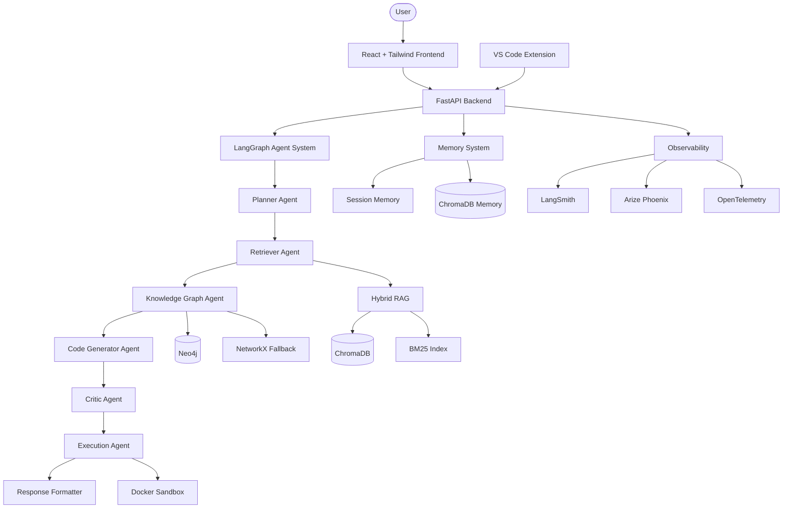

# ArchonAI Architecture

## System Overview

ArchonAI is a production-grade agentic code intelligence platform combining multi-agent orchestration, hybrid retrieval, knowledge graphs, fine-tuned LLMs, and enterprise observability.

## Agent Pipeline

| Agent | Responsibility |
|-------|---------------|
| Planner | Intent classification, execution planning, repository selection |
| Retriever | Hybrid vector + BM25 search with RRF fusion |
| Knowledge Graph | Dependency discovery, inheritance analysis |
| Code Generator | Code generation, explanations, Mermaid diagrams |
| Critic | Hallucination detection, quality scoring |
| Execution | Sandbox execution with self-correction |
| Formatter | Citation attachment, confidence scoring, streaming |

## Deployment Targets

- **Local**: `uvicorn backend.app.main:app`
- **Docker**: `docker compose -f docker/docker-compose.yml up --build`
- **Railway**: Deploy backend container with env vars
- **Hugging Face Spaces**: Gradio/Streamlit evaluation dashboard
- **Vercel**: Frontend static deployment
- **AWS EC2**: Full stack with Docker Compose
